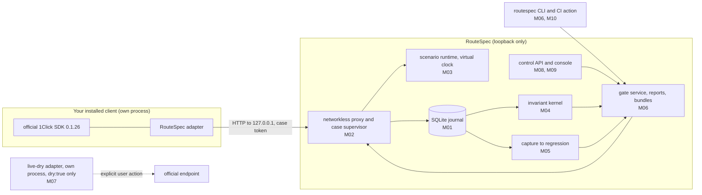

# RouteSpec

RouteSpec is a local release check for applications that use NEAR Intents 1Click through the
official TypeScript SDK. It runs your installed client against a networkless, protocol-faithful
local 1Click service, injects deterministic faults, records what the client did, and returns
PASS, FAIL, or REVIEW from a pure invariant kernel. A failing case can be captured and promoted
into a regression that the next build must pass.

Built during NEAR HACKATHON (2026-11). License: MIT ([`LICENSE`](LICENSE)).

## 30-second summary

- **Problem.** A 1Click deposit moves real funds across chains and cannot be undone. The risky
  moment is when the service accepts a deposit submission but the client never sees the answer
  (timeout, crash, dropped connection). A naive client resubmits, gives up, or ships the order
  anyway. There is no Intents testnet, so these paths are hard to test before release.
- **What RouteSpec does.** It replaces the 1Click endpoint with a loopback simulator during a
  test, plays an exact fault schedule such as "commit accepted, response lost", and checks the
  client against eight invariants (for example: reconcile before retrying under uncertainty, and
  hold protected side effects until accepted completion evidence exists). The result comes with a checksummed evidence bundle and JSON, JUnit,
  and SARIF reports.
- **What you will see.** The repository ships three client builds that use the pinned official
  SDK. The naive build resubmits and gives up without reconciling: its gate result is REVIEW.
  A second naive build "hedges" a slow deposit submission by placing a second order while the
  first is still unanswered: its gate result is FAIL (INV-03), with or without Docker. The
  corrected build reconciles through the read-only status route: its gate result is PASS when
  subjects run contained (Docker), and REVIEW without Docker because RouteSpec will not count a
  client's own hooks as proof of its side effects.
- **No funds, no keys.** RouteSpec never signs, holds a credential, or moves funds. Everything in
  the judge path below runs offline on 127.0.0.1.

## Try it in 10 minutes

Needs Node.js 22.18 or later, pnpm 10, and git. No Docker, no account, no API key. Every command
below was run from a fresh clone of `main` on Windows 11 (Git Bash and PowerShell) on 2026-11-13.
On Linux and macOS the commands are the same; they were not run by hand on those hosts for this
record, but `pnpm run check` runs there in CI (see [Status](#honest-status)).

**1. Install and build** (about 1 minute)

```sh
git clone https://github.com/gnanam1990/routespec-near.git routespec
cd routespec
corepack enable                    # or: npm install -g pnpm@10.34.9
pnpm install --frozen-lockfile
pnpm run build
pnpm run build:console
```

See: `pnpm install` ends with `Done`; both builds exit 0 (the console build prints a `dist/`
file list). `pnpm install` also prints a boxed notice `Ignored build scripts: esbuild` and
suggests `pnpm approve-builds`. That is expected and harmless: pnpm 10 does not run dependency
install scripts unless approved, and esbuild (used by Vite for the console build) gets its
platform binary from its `@esbuild/*` optional package instead. Nothing below needs
`pnpm approve-builds`.

**2. Run the whole product journey** (about 10 seconds)

```sh
pnpm run delivery:journey -- --work .data/demo --out .data/journey.json --no-ui
node scripts/journey-summary.mjs .data/journey.json
```

`.data/` is ignored by git. The journey starts the real control service, registers a project
and the three client builds through the public API, runs each build as its own process, captures
the failure, promotes it to a regression, reruns, exports a bundle, crashes and restarts the
service, and verifies the bundle offline. No verdict is hand-written: every verdict below is the
invariant kernel's result over what the client process actually sent.

See (abridged):

```text
containment UNCONTAINED
baseline client, release corpus: gate decision REVIEW
  case 0 accepted-then-lost-response: client GAVE_UP (resubmissions answered: 401 RS_TOKEN_REVOKED, ...) | INV-03 REVIEW | INV-04 REVIEW | ...
hedging client, slow-answer corpus: gate decision FAIL
  case 0 slow-commit-answer: client HEDGED (second quote and deposit submitted while the first was unanswered; run operations 2) | INV-03 FAIL | INV-04 REVIEW | effect coverage DECLARED_HOOKS_ONLY | case verdict FAIL
corrected client, promoted corpus: gate decision REVIEW
  case 0 accepted-then-lost-response: client RECONCILED | INV-03 PASS | INV-04 REVIEW | effect coverage DECLARED_HOOKS_ONLY | ...
capture as release evidence: refused 422 RS_CAPTURE_NOT_RELEASE_EVIDENCE (DECLARED_HOOKS_ONLY, ...)
promoted as DIAGNOSTIC_ONLY
evidence bundle verified offline: true
crash recovery: epoch 1 -> 2, stale token RS_TOKEN_REVOKED, second mutation RS_TOKEN_PHASE_DENIED
```

Read it as: the naive client lost the response, its resubmissions were refused, and it never
reached an accepted terminal status (INV-03 REVIEW).

The hedging client ([`hedging-client.ts`](packages/regressions/test/support/subject/hedging-client.ts))
is the FAIL case. It ran the `slow-commit-answer` scenario
([`scenarios.ts`](packages/delivery/src/scenarios.ts)), where the simulated service accepts the
deposit submission but holds its answer until the client reads status. After 750 ms without an
answer the client requested a fresh quote under a new order key, submitted a second deposit, and
cancelled the first request. The journal shows a quote finalization and a second commit accepted
after the first commit and before any terminal status for it, so the kernel returns INV-03 FAIL
(a mutation was accepted while a commit outcome was still unknown). The case, the gate, the
console, and the CLI (`gate show`, exit code 2) all report FAIL. The scenario states no expected
verdict, and RouteSpec did not refuse the second order: when it arrived, no response had been
lost yet, so there was nothing to fence.

The corrected client reconciled to `SUCCESS` (INV-03 PASS). Its gate stays REVIEW here only
because, without containment, the side-effect check (INV-04) has nothing but the client's own
hooks, and the uncontained capture is refused as release evidence. Step 4 shows the contained run
where the corrected build passes.

**3. Open the console on the same data**

```sh
node packages/control-api/src/main.ts --data .data/demo/data --console apps/console/dist --handoff stderr
```

See: one JSON line with the origin, then `routespec: console http://127.0.0.1:<port>/#token=...`.
Open that URL (the token is removed from the address bar on load). The Releases page lists five
gate runs for `release-candidate-1` with Verdict, Evidence, Subject identity ("User-asserted local
build"), Effect coverage ("Declared hooks only — REVIEW"), and Enforcement ("Local advisory").
The Gate summary at the top shows the most recent gate run (the corrected build), says so, and
names its gate run id; select a row in the matrix to see another. The second row, Verdict FAIL,
is the hedging build: "Open gate run" shows its case with INV-03 FAIL. "Open gate run" shows each
case with its invariants, run operations, and the export panel. Stop
the service with Ctrl+C. Reloading the page drops the session by design; start the service again
for a new link.

**4. Optional: the contained run where the corrected client passes** (about 1 minute, needs Docker)

Docker is needed only for containment. Pull the image once, point RouteSpec at the engine, and
add `--contained`:

```sh
docker pull node:22-bookworm-slim
export ROUTESPEC_CONTAINER_CLI='["docker"]'          # Docker Engine on Linux
pnpm run delivery:journey -- --work .data/demo-contained --out .data/journey-contained.json --no-ui --contained
node scripts/journey-summary.mjs .data/journey-contained.json
```

On Windows with Docker Engine inside WSL 2 (PowerShell):

```powershell
$env:ROUTESPEC_CONTAINER_CLI = '["wsl.exe","-d","Ubuntu-24.04","-u","root","--exec","docker"]'
pnpm run delivery:journey -- --work .data/demo-contained --out .data/journey-contained.json --no-ui --contained
node scripts/journey-summary.mjs .data/journey-contained.json
```

See:

```text
containment CONTAINED
baseline client, release corpus: gate decision REVIEW
  case 0 accepted-then-lost-response: client GAVE_UP (resubmissions answered: 403 RS_TOKEN_PHASE_DENIED, ...) | INV-03 REVIEW | INV-04 PASS | effect coverage INDEPENDENT_BOUNDARY_INTERCEPT | ...
hedging client, slow-answer corpus: gate decision FAIL
  case 0 slow-commit-answer: client HEDGED (second quote and deposit submitted while the first was unanswered; run operations 2) | INV-03 FAIL | INV-04 PASS | effect coverage INDEPENDENT_BOUNDARY_INTERCEPT | case verdict FAIL
corrected client, promoted corpus: gate decision PASS
  case 0 accepted-then-lost-response: client RECONCILED | INV-03 PASS | INV-04 PASS | effect coverage INDEPENDENT_BOUNDARY_INTERCEPT | case verdict PASS
capture as release evidence: accepted
promoted as RELEASE_EVIDENCE
regression status CORRECTED_RUN_PASSED
```

Containment does not change the hedging verdict: INV-03 is judged from the journal either way.
Opening the console on `.data/demo-contained/data` (step 3) shows the last gate run as PASS with
"Trusted launcher attestation" and "Independent boundary". Each subject ran in a container with
no network except a loopback tunnel to RouteSpec, a read-only root, no capabilities, a seccomp
filter, and an attested launch. The journey signs the interceptor profile review with a locally
generated test key, so this PASS is not an independent review (see Status). The WSL 2 variant
was verified for this record; the plain Linux `["docker"]` variant was not run here. Engine setup:
[`docs/runbooks/container-containment.md`](docs/runbooks/container-containment.md).

**5. Run the test suite**

```sh
pnpm run check
```

See: typecheck, ESLint, Prettier, Vitest, and the repository secret scan; on this record's commit (2026-11-13, Windows 11):
`Test Files 86 passed | 1 skipped (87)`, `Tests 727 passed | 6 skipped (733)`,
`secret-scan: clean`. One earlier full run (M40, fresh clone) had a single timing failure in
T-042 (an endless chunked body cut-off) under full parallel load; it passed on three isolated
reruns and on the next full run. Longer suites (`test:delivery`, `test:e2e:real`,
`test:containment`) are listed under [Verify](#verify).

## Add the RouteSpec gate to your CI

The repository contains a composite GitHub Action,
[`.github/actions/routespec-gate`](.github/actions/routespec-gate/action.yml). It installs
RouteSpec's pinned dependencies, removes provider secrets and CI tokens before its entry point
starts, runs the networkless gate (simulate and replay only), and stages redacted reports
(JSON, JUnit, SARIF, evidence bundle). The step exits 0 only for a PASS decision.

1. Add a `routespec.ci.json` (schema `routespec.ci-config/1`) to your repository. It names your
   client module, its artifact files, lockfile, declared effect manifest, scenarios, and required
   invariants. The repository's own self-gate config is a working example:
   [`.github/routespec/routespec.ci.json`](.github/routespec/routespec.ci.json).
2. Add a workflow step, pinned to a reviewed commit of this repository:

   ```yaml
   permissions:
     contents: read
   jobs:
     routespec:
       runs-on: ubuntu-24.04
       steps:
         - uses: actions/checkout@11bd71901bbe5b1630ceea73d27597364c9af683 # v4.2.2
           with:
             persist-credentials: false
         - id: gate
           uses: gnanam1990/routespec-near/.github/actions/routespec-gate@<reviewed-commit-sha>
           with:
             config: routespec.ci.json
         - if: ${{ always() && steps.gate.outputs.upload-directory != '' }}
           uses: actions/upload-artifact@b4b15b8c7c6ac21ea08fcf65892d2ee8f75cf882 # v4.4.3
           with:
             name: routespec-gate-${{ github.run_id }}
             path: ${{ steps.gate.outputs.upload-directory }}
             retention-days: ${{ steps.gate.outputs.retention-days }}
   ```

   A reusable-workflow version is in
   [`docs/ci/routespec-gate.reusable.example.yml`](docs/ci/routespec-gate.reusable.example.yml).

3. Outputs: `conclusion`, `decision`, `exit-code`, `trust`, `enforcement-mode`, `artifact-ready`.
   Pull-request and fork jobs get no secrets and upload only redacted reports. Enforcement is
   reported as `CI_CHECK` or `REQUIRED_CHECK_UNVERIFIED`; RouteSpec never claims it blocks a
   merge. The action does not use containment.

The action's behaviour was tested with a simulated runner environment (T-056, T-058), and it has
run on GitHub's hosted runners: the repository's self-gate workflow `routespec-gate`
(ubuntu-24.04) succeeded on `main` at `ab9b89f`
([run 43272644038](https://github.com/gnanam1990/routespec-near/actions/runs/43272644038)) and at
`bfd3065` ([run 43357797080](https://github.com/gnanam1990/routespec-near/actions/runs/43357797080)).
The step exits 0 only for a PASS decision, so the sample subject's gate decision was PASS.

## NEAR integration: exactly what is used

| Used                                                         | How                                                                                                                                                                                                                                                |
| ------------------------------------------------------------ | -------------------------------------------------------------------------------------------------------------------------------------------------------------------------------------------------------------------------------------------------- |
| NEAR Intents 1Click TypeScript SDK                           | `@defuse-protocol/one-click-sdk-typescript` pinned at `0.1.26` ([ADR-0002](docs/adr/0002-official-1click-sdk-pin.md)). The clients under test call it unchanged; RouteSpec only points its base URL at the loopback proxy.                         |
| 1Click API protocol (`oneclick-v0` profile)                  | The local service implements `/v0/quote`, `/v0/deposit/submit`, and `/v0/status` and the status lifecycle (`PROCESSING`, `SUCCESS`, `REFUNDED`, `FAILED`, ...) as a data-only model. Unknown routes never pass through.                            |
| 1Click official endpoint, `dry: true` quotes only (optional) | A separate live-dry adapter can send at most one `dry: true` quote to `https://1click.chaindefuser.com`; committed quotes, deposits, and signatures are refused before any credential, DNS lookup, or socket. **Not run** for this record (RP-07). |

Not used: NEAR smart contracts, NEAR RPC, wallets, signing, chain signatures, testnet or mainnet
transactions. Nothing ran on NEAR testnet: NEAR Intents has no testnet, and RouteSpec is
networkless by design. Why NEAR: 1Click settles cross-chain and is irreversible, so a client bug
around a lost response can double-deliver or deliver on a refund. RouteSpec tests exactly that
boundary of a NEAR Intents integration before release.

## Honest status

Full record: [`BUILD-STATUS.md`](BUILD-STATUS.md); per-module evidence in
[`docs/status/`](docs/status/); what only the owner can do:
[`docs/USER-NEXT-STEPS.md`](docs/USER-NEXT-STEPS.md).

- **Claim level: no `WORKING_*` level is claimed.** The real CI run (RP-05) is now observed (next
  item). `WORKING_LOCAL` still needs (1) a review of the canary interceptor profile by a reviewer
  independent of the operator, with their own key (RP-02/RP-06), (2) a contained gate run in a
  data directory that holds that review, so INV-04 and the capture classification rest on it,
  and (3) a rerun of `pnpm run test:delivery` with the engine configured on that same commit. The
  journeys review the profile with a locally generated test key held by the operator, so (1) is
  not met.
- **Real CI (RP-05): observed.** GitHub Actions `ci` ran green from a clean checkout of `main` at
  `ab9b89f` on ubuntu-24.04, windows-2022, and macos-15
  ([run 43272644091](https://github.com/gnanam1990/routespec-near/actions/runs/43272644091)), and
  again at `bfd3065`
  ([run 43357797047](https://github.com/gnanam1990/routespec-near/actions/runs/43357797047));
  `routespec-gate` ran green on both commits (see the CI section). Commits made after `bfd3065`
  are covered only once they are pushed and their runs are green.
- **What ran:** modules M00–M18 and ten security fixes, merged locally; the uncontained and
  contained journeys (above); `pnpm run check`; the console against the real service
  (Playwright + axe, Chromium); container escape and container-host access tests on Docker
  Engine in WSL 2, all on Windows 11 x64; and `pnpm run check` on Linux and macOS through the CI
  runs above.
- **What ran on testnet:** nothing (see NEAR integration).
- **Not done:** the independent interceptor profile review (above); the official `dry: true`
  probe (needs a user-held 1Click JWT); the contained journey and `test:delivery` on Linux and
  macOS hosts; Firefox, WebKit, and screen readers; an independent human security review; plain
  Linux Docker and rootless engines. RouteSpec has no funded mode and no hosted deployment.

## Security

Two security audits were run against this code by the team itself. Both were self-run; neither
is a third-party audit. Every confirmed finding was first reproduced with a failing test on the
real code, then fixed, and each has its own evidence record in [`docs/status/`](docs/status/):

- **[Strix](https://github.com/usestrix/strix) 1.7.0**, an open-source automated
  penetration-testing agent, run by the team against this repository: 3 findings, all fixed —
  [vuln-0001](docs/status/SEC-routespec-vuln-0001.md) (medium, withheld CI credentials readable
  through `/proc/<pid>/environ`), [vuln-0002](docs/status/SEC-routespec-vuln-0002.md) (low,
  credential shapes missed after a word character),
  [vuln-0003](docs/status/SEC-routespec-vuln-0003.md) (low, auth-failure budget locked out the
  operator).
- **Cloudflare's open-source
  [security-audit skill](https://github.com/cloudflare/security-audit-skill) methodology**,
  applied by the team to this repository: 7 findings, all fixed — [RS-01](docs/status/SEC-routespec-RS-01.md) (medium, unauthenticated interceptor
  sink), [RS-02](docs/status/SEC-routespec-RS-02.md) (contained subject could write to the host
  control channel), [RS-03](docs/status/SEC-routespec-RS-03.md) (pre-authentication rate budget),
  [RS-04](docs/status/SEC-routespec-RS-04.md) (quarantine dropped blocking findings past 512),
  [RS-05](docs/status/SEC-routespec-RS-05.md) (journal readable by other local users),
  [RS-06](docs/status/SEC-routespec-RS-06.md) (connection barriers keyed by step id only),
  [RS-07](docs/status/SEC-routespec-RS-07.md) (gate kept PASS for a revoked attester); RS-02 to
  RS-07 are low.

Known remaining limits are stated in those records (for example, hostile code inside the CI
action process is not contained). An independent human security review is still NOT_RUN. The
fix branches are `feat/routespec-m20-*` to `feat/routespec-m29-*`, one per finding (see
[Layout](#layout)).

## Hackathon disclosure

- **Built during NEAR HACKATHON.** The repository's first commit is 2026-11-11 (import of the
  RouteSpec specification pack in [`docs/spec/`](docs/spec/START-HERE.md)); all code was written
  from 2026-11-11 to 2026-11-13. No pre-existing code from any other project is included, so the
  whole history is the hackathon work.
- **Third-party libraries** (all from npm, pinned in `pnpm-lock.yaml`): the official 1Click SDK
  above, zod, yaml, React, react-router, Vite, Vitest, Playwright, axe-core, fast-check,
  TypeScript, ESLint, Prettier, node-forge (test certificates only), and Fontsource fonts. Storage
  uses Node's built-in `node:sqlite`.
- **Sibling project.** The same lead also entered
  [Dockside](https://github.com/gnanam1990/dockside-near), an independent supplier-trade escrow
  product for importers, suppliers, and named inspectors. RouteSpec and Dockside have separate
  repositories, code, state, demos, and submissions; neither is a second submission of the other.

---

The sections below are the detailed engineering reference.

The authoritative specification is the sealed pack in [`docs/spec/`](docs/spec/START-HERE.md).
This repository implements it module by module (M00–M18).

## Status (2026-11-12, verified on win32/x64; containment on Docker Engine in WSL 2)

- All modules M00–M17 are implemented and merged locally; M18 re-ran the full regression and
  consolidated the records. Exactly what passed, what is partial, and what is blocked is in
  [`BUILD-STATUS.md`](BUILD-STATUS.md), with one record per module in
  [`docs/status/`](docs/status/).
- From a clean clone, the installed product runs the whole local journey with the pinned
  official SDK: the baseline client fails the lost-response case, the failure is captured and
  promoted to a regression, and a genuinely corrected client passes (`pnpm run test:delivery`).
- **Containment (M14, M17).** With a Linux container engine configured, every subject case runs
  confined (no network but a loopback tunnel to RouteSpec, read-only root, no capabilities,
  non-root, an active seccomp filter), launches are attested by an enrolled launcher key, and an
  independent interceptor observes the protected effect. Real escape attempts are blocked, and
  no container (bridge, host-network, or confined) reached any RouteSpec listener on this host
  (T-036 container-host part, `pnpm run test:containment`). Without an engine those tests report
  NOT_RUN.
- **Release evidence (M16, RP-08).** Captures that are declared-hooks-only, unconfined, not
  independently observed, unattested, interceptor-incomplete, or made under an unreviewed
  interceptor profile are **refused** as release evidence (`RS_CAPTURE_NOT_RELEASE_EVIDENCE`,
  HTTP 422, CLI exit 6) at promotion, corpus creation, gate aggregation, and export. Promoting
  one anyway is an explicit `DIAGNOSTIC_ONLY` choice that adds only an ADVISORY case, and its
  bundle says so (`routespec.bundle/2`, `evidenceUse`).
- **Interceptor profile review (M16).** A profile becomes `REVIEWED` only through an Ed25519
  signature by an enrolled reviewer whose key is not a launcher key; INV-04 needs an effective
  review. The journeys use a locally generated **test** reviewer key; an independent review is
  NOT_RUN ([runbook](docs/runbooks/interceptor-profile-review.md)).
- **No `WORKING_*` gate level is claimed.** The green clean-checkout run on a real CI service
  (RP-05) is now observed: GitHub Actions `ci` run 43272644091 on `ab9b89f` (ubuntu-24.04,
  windows-2022, macos-15). `WORKING_LOCAL` still needs a review of the interceptor profile by a
  reviewer independent of the operator, followed by a contained gate run on that review
  (RP-02/RP-06) and a `test:delivery` rerun on that commit. The official live dry probe (RP-07)
  has not been run; it needs your own provider JWT.
- Enforcement is advisory: `LOCAL_ADVISORY`, `CI_CHECK`, or `REQUIRED_CHECK_UNVERIFIED`.
  RouteSpec never says it blocks a merge or a release.
- Not run: the contained journey on Linux and macOS hosts, Firefox and WebKit, screen readers,
  an independent security review. What you can do next: [`docs/USER-NEXT-STEPS.md`](docs/USER-NEXT-STEPS.md).

### Dependencies

- zod 4.6.7, react-router 7.18.5, vitest 4.1.12 (M13); minimatch 11.0.3 through a scoped pnpm
  override (M17, ADR-0020).
- `pnpm audit` (2026-11-12): 4 advisories, all node-forge 1.4.2 (dev only), patched in 1.4.3,
  which is held by the two-week cool-down until 2026-11-18.

## Requirements

- Node.js `>= 22.18` (built-in type stripping and `node:sqlite`; verified on 22.23.1)
- pnpm 10 (`corepack enable` or a global install)
- git
- Windows, Linux, or macOS. No C toolchain is needed. The console acceptance suites need
  Playwright's Chromium (`pnpm --filter @routespec/console exec playwright install chromium`).
- Optional, for subject containment: a Linux container engine (Docker Engine on Linux, or Docker
  Engine inside WSL 2 on Windows; Docker Desktop is not needed) and the image
  `node:22-bookworm-slim` pulled once. Setup: [`docs/runbooks/container-containment.md`](docs/runbooks/container-containment.md).

## Install and build

```sh
pnpm install --frozen-lockfile     # works with --offline once the pnpm store has the lockfile's packages
pnpm run build                     # tsc -b over all project references (strict)
pnpm run build:console             # production console bundle in apps/console/dist
```

## Run it

```sh
# Loopback control service (127.0.0.1) with the console, journal in ./.data
node packages/control-api/src/main.ts --data .data --console apps/console/dist
```

The service prints one JSON line with its origin. On an interactive terminal it also prints a
one-time console URL whose `#token=` fragment carries the ephemeral control token (removed from
the address bar on load). Every `/__routespec/v1` request needs `Authorization: Bearer <token>`;
mutations need `Idempotency-Key` and, for updates, `If-Match`.

The `routespec` CLI (`node packages/cli/src/main.ts <command>`) prints one JSON document on stdout.
Exit codes: 0 PASS, 2 FAIL, 3 REVIEW or NOT_RUN, 4 configuration error, 5 internal or corrupted
state, 6 safety policy denial. Main commands: `project create`, `revision register`,
`build register`, `effect manifest`, `effect policy`, `scenario validate|add`, `corpus create`,
`gate create|run|evaluate|show`, `case recover`, `regression evidence|promote [--diagnostic-only]`,
`profile review-status|review-sign`, `export plan [--evidence-use]|write|verify`. `gate run` hands each
case to your client through the reviewed launcher (`runWithLauncher` from `@routespec/cli`);
RouteSpec never runs your commands.

The end-to-end journey (`pnpm run delivery:journey -- --work <empty dir> --out <file.json>`)
drives a fresh data directory through the control API, console, and CLI with the two reference
client builds, and writes the evidence record to the JSON file. Add `--contained` (with
`ROUTESPEC_CONTAINER_CLI` set) to run every subject case confined, with attested launches.

Containment in the service: start it with `--subject-root <checkout> --container-cli '<json>'
--launcher packages/containment/src/attesting-launcher.ts --launcher-key <key file>` and start
cases with `POST /__routespec/v1/case-runs/{id}/contained-start`; the case token goes only to the
confined subject. Details in the runbook.

## Verify

| Command                       | What it does                                                                                                                                                                                                            |
| ----------------------------- | ----------------------------------------------------------------------------------------------------------------------------------------------------------------------------------------------------------------------- |
| `pnpm run check`              | typecheck (all projects), ESLint, Prettier check, the Vitest suite, repository secret scan                                                                                                                              |
| `pnpm test`                   | Vitest suite for every package (`packages/*/test`, `apps/*/test`)                                                                                                                                                       |
| `pnpm run test:e2e:real`      | builds the console, starts a real control service seeded through the API by official-SDK subjects, runs Playwright + axe (T-047..T-052)                                                                                 |
| `pnpm run test:delivery`      | clones HEAD into an empty directory, installs offline, builds, runs the full journey, regressions, uninstall and reinstall (T-054, T-055), and the contained journey when an engine is configured (about three minutes) |
| `pnpm run test:containment`   | container runtime tests: real escape attempts, container-host access (T-036), and contained cases through the control service (NOT_RUN with a reason when no engine is reachable)                                       |
| `pnpm run test:e2e`           | console fixture suite (simulated API; development only)                                                                                                                                                                 |
| `pnpm run audit:supply-chain` | offline lockfile, license, and install-script audit                                                                                                                                                                     |

Node prints an `ExperimentalWarning` for `node:sqlite`; it is expected.

## How it fits together



The scenario runtime never has a network path or a provider credential. The live-dry adapter is
a separate process with its own compatibility ledger; its result never changes a local verdict.

## Layout

```text
packages/contracts         M00  closed versioned schemas, enums, rs-canon/1 digests, oneclick-v0 protocol profile
packages/store             M01  single-writer node:sqlite WAL journal, migrations 001-009, fenced tokens, recovery, reviews
packages/proxy             M02  networkless loopback proxy, case supervisor, redaction, interceptor channel
packages/client-adapter    M02  attaches the pinned official SDK to the proxy
packages/scenario          M03  data-only scenario DSL, compiler, virtual clock, deterministic faults, core scenarios
packages/kernel            M04  pure invariant kernel INV-01..INV-08, evidence classes and scopes
packages/regressions       M05  quarantine, sanitization, mapping, replay verification, review, promotion, corpora
packages/runner            M06  gate service, aggregation, JSON/JUnit/SARIF reports, checksummed bundles
packages/cli               M06  `routespec` CLI and the reviewed launcher
packages/live-dry-adapter  M07  separately launched dry-quote adapter (official SDK pin lives here)
packages/control-api       M08  loopback control API, attestation, build matrix, console hosting
apps/console               M09  accessible React console over the control API
packages/ci                M10  `routespec-ci` (trust classification, redacted uploads, SBOM); .github/
packages/hardening         M11  path policy, canary scanner, OS views, supply-chain audit
packages/security-suite    M11  security acceptance tests against the assembled product
packages/delivery          M12  clean install, end-to-end journey (uncontained and contained), delivery tests
packages/containment       M14  container launcher, loopback tunnel, containment verification, attesting launcher
docs/adr                        architecture decision records 0001-0025
docs/runbooks                   container-containment.md (WSL 2 + Docker Engine), interceptor-profile-review.md
docs/status                     per-module evidence
docs/spec                       sealed specification pack (never edited)
```

Branches: each module was built on its own `feat/routespec-mNN-*` branch and merged into `main`
with `--no-ff`; every branch is kept. M00–M18 are the build modules, M19 the reviewer kits, and
M40 onward the hackathon write-up and screening fixes. The `feat/routespec-m20-*` to
`feat/routespec-m29-*` branches are not modules: they are security-fix branches, one per audit
finding (m20 vuln-0001, m21 vuln-0002, m22 vuln-0003, m23 RS-01, m24 RS-02, m25 RS-03, m26 RS-04,
m27 RS-05, m28 RS-06, m29 RS-07; see [Security](#security)).

## Module notes

- **Proxy and adapter (M02).** The proxy serves only `/v0/quote`, `/v0/deposit/submit`, and
  `/v0/status` on 127.0.0.1; unknown routes never pass through.
- **Kernel (M04).** A pure function from a journal snapshot to verdicts with separate evidence
  class, scope, and reason. Declared hooks alone are REVIEW for protected effects.
- **Capture-to-regression (M05).** A failing installed case is captured, quarantined, sanitized,
  mapped, replay-verified (including a separate process), reviewed (8 decisions plus a
  confirmation phrase), and promoted into a new scenario and a new corpus. It counts as fixed
  only after a different build passes the promoted case through the normal path.
- **Release-evidence refusal and profile review (M16).** One journal-derived classification
  (`GET /imports/{id}/release-evidence`, `routespec regression evidence`) decides whether a
  capture is release evidence; promotion, corpora, gate aggregation (`routespec-gate@1.2.0`),
  and export all apply it. Reviewers are separate principals (migration 009) enrolled with a
  local confirmation; a review is an Ed25519 signature over a server-built statement
  (`routespec profile review-sign` signs offline), immutable, and revocable only by an
  append-only record. INV-04 (`routespec-kernel@1.1.0`) needs an effective review recorded before
  the case input closed, so gate runs pinned to the 1.0.0 evaluator are `GATE_EVALUATOR_STALE`.
- **Release gates (M06).** Gate runs are immutable; an interrupted case never contributes PASS;
  reports come from one persisted evaluation; `export plan|write|verify` produces a redacted,
  checksummed (unsigned) bundle, and artifact readiness never changes the decision. Bundles are
  `routespec.bundle/2` since M16: they declare `evidenceUse` and carry the signed profile
  reviews, which `verify` checks offline.
- **Live dry adapter (M07).** At most one `dry: true` quote to the pinned official origin, with
  every committed or fund-moving request denied before credential, DNS, or socket. Run only on
  your explicit action: see `docs/USER-NEXT-STEPS.md`.
- **Control API (M08).** Host, Origin, and Fetch-Metadata are checked on every request; no CORS
  is granted; attester enrollment needs a second local confirmation code.
- **Console (M09).** Renders persisted records only and never computes a verdict; keyboard
  complete, WCAG 2.2 AA checked with axe, responsive from 375 px.
- **CI (M10).** `routespec-ci run --config routespec.ci.json` through the reviewed launcher;
  pull-request and fork jobs get no provider secrets and upload only redacted reports; CI builds
  stay `USER_ASSERTED_LOCAL`. Hosted runs: `ci` and `routespec-gate` green on GitHub Actions
  (see [Honest status](#honest-status)).
- **Containment (M14).** `@routespec/containment` detects the engine, starts the subject's process
  tree in a container whose only channel is a stdio tunnel to the proxy and the interceptor sink,
  verifies the engine's record and the container's self-observation (fail closed), and supplies
  the attesting launcher. The service binds the interceptor at the case's current epoch, releases
  protected effects only after ground truth proves accepted completion, and journals an immutable
  containment record per case. Gate runs may select one effect policy per scenario.
- **Container-host access (M17).** The T-036 runtime test starts RouteSpec's real listeners on
  this host and tries every port at every host, engine-host, gateway, and loopback address from a
  bridge container, a host-network container, and the confined subject, with a positive control
  that proves the attempts are not vacuous. The launcher now requires `Seccomp: 2` in the
  container's self-observation and closes every tunnel connection with the subject.
- **Hardening (M11).** `ROUTESPEC_CONFIGURED_SECRETS` (one value per line, read once) are refused
  or redacted at every boundary; `--handoff stderr|ipc|none`; local logs in
  `<data>/logs/control.jsonl`; `GET /__routespec/v1/metrics` (no telemetry); retention purge with
  a dry run and a confirmation digest.

## Safety boundary

RouteSpec has no funded mode. Nothing in this repository creates accounts, holds a provider
credential, signs a transaction, moves funds, or contacts the hosted 1Click API on its own. The
only modes are SIMULATE and REPLAY (networkless) and LIVE_DRY_PROBE (a separate adapter process,
`dry: true` only, after an explicit user action). RouteSpec is an independent project; it shares
no code, state, or repository with any other submission.
