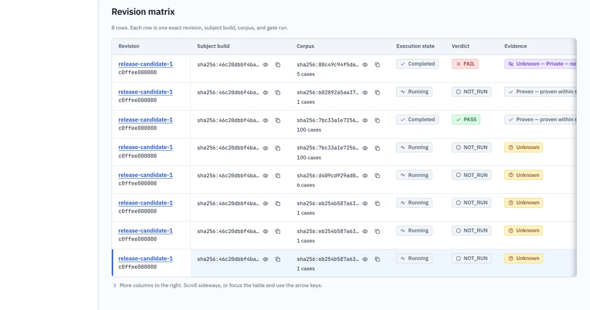
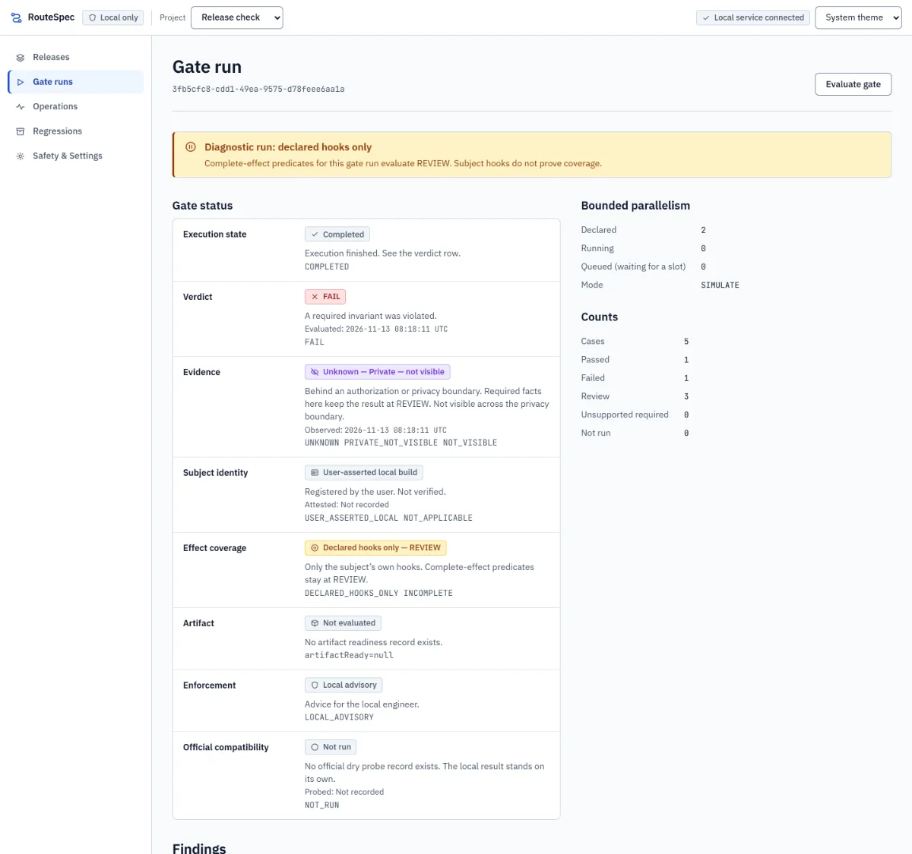
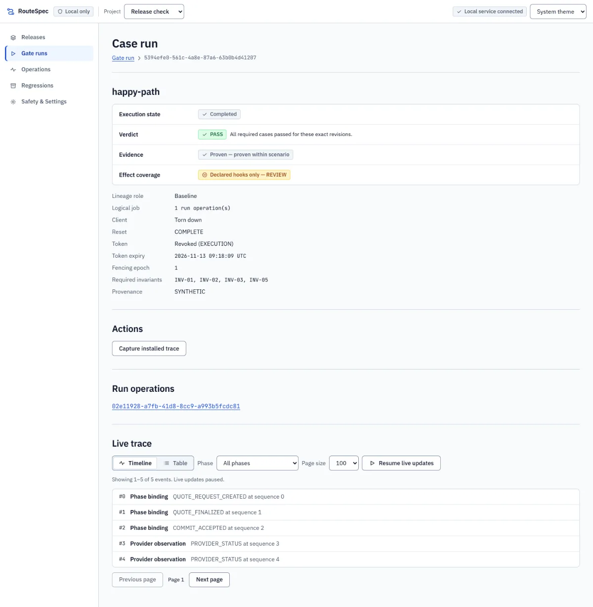
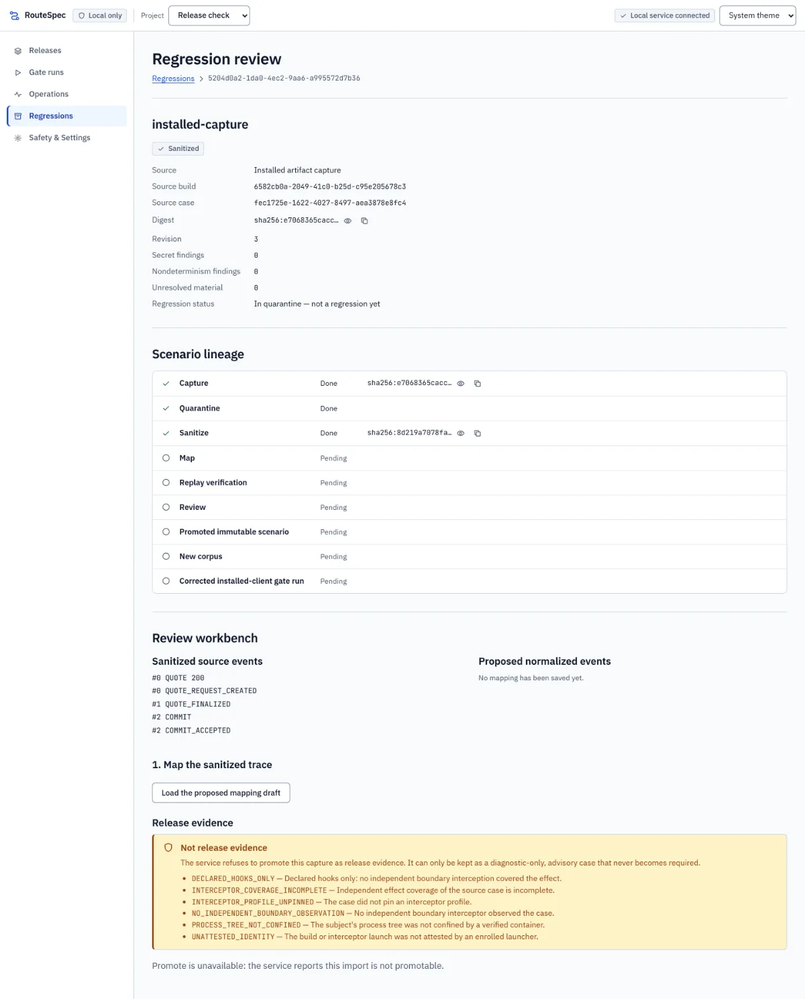

# RouteSpec

A local release check for apps that use NEAR Intents 1Click: it runs your real client against a
simulated 1Click service, breaks the network on purpose, and tells you whether the client would
have lost or duplicated a cross-chain order.

[](https://github.com/gnanam1990/routespec-near/actions/workflows/ci.yml)
[](LICENSE)

Demo video: <added after recording>

- **Verify page and console demo (no install):** `https://gnanam1990.github.io/routespec-near/`
  (verify page) and `https://gnanam1990.github.io/routespec-near/console/` (read-only console
  recorded from a real contained run). Published after the `routespec-pages` workflow runs with
  GitHub Pages enabled; not live yet ([M49](docs/status/M49.md), [M54](docs/status/M54.md)).
- **Hosted app:** pending. RouteSpec is local-first; the judge path below runs on your machine.
- **Engineering reference:** [`docs/ARCHITECTURE.md`](docs/ARCHITECTURE.md). Evidence per module:
  [`docs/status/`](docs/status/). Claim record: [`BUILD-STATUS.md`](BUILD-STATUS.md).

## 30-second summary

- **Problem.** A 1Click deposit moves real funds across chains and cannot be undone. The dangerous
  moment is when the service accepts a deposit but the app never hears back (timeout, crash,
  dropped connection). A naive app then gives up, or places a second order. NEAR Intents has no
  testnet, so this path is hard to test before release.
- **What RouteSpec does.** During a test it points the official 1Click TypeScript SDK at a
  loopback simulator, plays an exact fault such as "deposit accepted, answer lost", records every
  request the client process made, and returns **PASS**, **FAIL** or **REVIEW** from a pure
  invariant kernel ([`packages/kernel`](packages/kernel/src/evaluate.ts)). A failing case can be
  captured and promoted into a regression that the next build must pass.
- **Why NEAR.** 1Click settles cross-chain and irreversibly; a client bug around a lost response
  double-delivers or ships on a refund. RouteSpec tests exactly that boundary of a NEAR Intents
  integration, using the pinned official SDK unchanged, and checks its simulator against the real
  1Click API with `dry: true` quotes (no funds). Release decisions can be recorded as signed
  certificates in a NEAR contract (built and sandbox-tested; testnet deployment pending).

### The story in one run: FAIL, then REVIEW, then PASS

The repository ships three client builds that call the official SDK. The verdicts below are the
kernel's output over what each client process actually sent; nothing is hand-written.

| Client build                                                                   | What it does when the answer is late or lost                                              | Verdict                                                    |
| ------------------------------------------------------------------------------ | ----------------------------------------------------------------------------------------- | ---------------------------------------------------------- |
| [hedging](packages/regressions/test/support/subject/hedging-client.ts)         | after 750 ms without an answer it places a **second order** while the first is still open | **FAIL** (INV-03: second order under uncertainty)          |
| [naive baseline](packages/regressions/test/support/subject/baseline-client.ts) | resubmits, is refused, gives up without ever learning the outcome                         | **REVIEW** (outcome never established)                     |
| [corrected](packages/regressions/test/support/subject/corrected-client.ts)     | reads `/v0/status` for the same deposit until it is terminal (reconciles)                 | **PASS** when run contained; REVIEW without Docker (below) |

Why the corrected build is REVIEW without Docker: RouteSpec will not take a client's own word for
its side effects. Only when the client runs in a sealed container with an independent observer
does it count the evidence and give PASS.

What is proven today: the whole journey runs end to end from a fresh clone, offline, and the
FAIL, REVIEW and PASS above are real kernel verdicts over real client processes; and the real
1Click API answered 24 of 26 `dry: true` routes in the exact shape RouteSpec simulates (2 unknown,
0 different). The specification's formal label
`WORKING_LOCAL` is still withheld until a second person reviews the interceptor profile and the
contained run is repeated on that review ([Honest status](#honest-status)).

### Glossary

- **PASS / FAIL / REVIEW / NOT_RUN**: proven safe / a rule was broken / not enough independent evidence to pass / did not run
- **INV-01**: one logical job maps to one run operation
- **INV-02**: an order's binding (quote, deposit address, commit) never changes after it is made
- **INV-03**: reconcile before retry: after an unknown outcome, only status reads until a terminal result
- **INV-04**: protected side effects (shipping goods, granting access) wait for accepted completion evidence
- **INV-05**: value is conserved per asset; any unexplained loss is FAIL
- **INV-06**: a terminal outcome is never silently replaced by a later, weaker one
- **INV-07**: one piece of evidence satisfies at most one order
- **INV-08**: weak or missing evidence cannot satisfy a claim that needs proof
- **Gate run / corpus / case**: one release check of one build / the fixed set of scenarios it runs / one scenario run in isolation
- **Contained**: the client runs in a locked-down container (no network except a tunnel to RouteSpec, read-only root, seccomp, attested launch)
- **Declared hooks only**: uncontained: only the client's own reports of its side effects exist, so INV-04 stays REVIEW
- **Release evidence / `DIAGNOSTIC_ONLY`**: a capture strong enough to gate a release / a weaker capture kept only as advice
- **`dry: true` quote**: a 1Click quote that never creates a deposit address and never moves funds
- **Release certificate / attester**: a signed on-chain record of a gate decision for an evidence bundle digest / the key allowed to sign it ([ADR-0029](docs/adr/0029-onchain-release-certificates.md))
- **`WORKING_LOCAL`**: the specification's strict claim level; needs every real-product gate met ([BUILD-STATUS](BUILD-STATUS.md))

The kernel's invariant code is in [`packages/kernel/src/invariants/`](packages/kernel/src/invariants/);
the normative text is [`docs/spec/CORE-CONTRACT.md`](docs/spec/CORE-CONTRACT.md).

## Screenshots

Console pages served by the real local control service over test data (the project uses a
placeholder commit id).









## See it on chain

**No NEAR testnet or mainnet transaction has been sent yet, so there is no explorer link to
show.** The on-chain part, release certificates in the `routespec-registry` contract
([`contracts/routespec-registry`](contracts/routespec-registry/crates/routespec-registry/src/lib.rs)),
is built and was run against a real local NEAR node; deploying it to testnet and publishing the
first certificate are owner steps ([runbook](docs/runbooks/release-certificates.md)). Every recorded run
that touched NEAR, and where it ran:

- **One `dry: true` quote, wNEAR -> USDC, official SDK profile**. Where it ran: official 1Click API (mainnet service, no funds). Result: `OFFICIAL_ENDPOINT_COMPATIBLE`, HTTP 201. Evidence: [M42](docs/status/M42.md).
- **Fidelity matrix, 26 routes, `dry: true` only**. Where it ran: official 1Click API (mainnet service, no funds). Result: `NO_DRIFT`: 24 compatible, 0 incompatible, 2 unknown. Evidence: [M51](docs/status/M51.md).
- **Registry contract: enrol, publish, tamper, replay, deposit, revoke (20 tests)**. Where it ran: local nearcore 2.14.0 sandbox node. Result: pass. Evidence: [test](packages/registry/sandbox-test/registry-contract.sandbox.test.ts), [M47](docs/status/M47.md), [M47A](docs/status/M47A.md).
- **CLI publishes and verifies real bundles (14) and CI certificate step (5)**. Where it ran: local nearcore sandbox node. Result: pass. Evidence: [M47](docs/status/M47.md).
- **Badge, CLI and built verify page agree (11; Chromium)**. Where it ran: local nearcore sandbox node. Result: pass (no certificate, PASS, FAIL, revoked attester). Evidence: [test](apps/verify/sandbox-test/m49-certified-badge.sandbox.test.ts), [M49](docs/status/M49.md).
- **Registry deployment, attester enrolment, first certificate**. Where it ran: NEAR testnet. Result: **pending (owner)**. Evidence: [runbook](docs/runbooks/release-certificates.md).

Reproducible contract build: wasm `sha256:bc6d8b9d…7b656`, NEAR code hash
`DgYXio822TH3CGJqfKU8gDFFSSqmxurWAwG1i4Jhqo5P` ([M47A](docs/status/M47A.md),
`pnpm run registry:reproduce`). The verify page expects the registry at
`gnanam1990-routespec.testnet` ([config](apps/verify/public/config.json)); its explorer page,
empty until deployment, is <https://testnet.nearblocks.io/address/gnanam1990-routespec.testnet>.

Read-only check (no key, no transaction):

```sh
curl -s https://test.rpc.fastnear.com -H 'content-type: application/json' -d '{"jsonrpc":"2.0","id":1,"method":"query","params":{"request_type":"view_account","finality":"final","account_id":"gnanam1990-routespec.testnet"}}'
```

On 2026-11-13 it returns `UNKNOWN_ACCOUNT` (not deployed). After deployment its `code_hash`
must equal `DgYXio822TH3CGJqfKU8gDFFSSqmxurWAwG1i4Jhqo5P`.

## Try it in 10 minutes

Needs Node.js 22.18 or later, pnpm 10 and git. No Docker, no account, no API key, no network after
install. Every command and output below was run from a fresh local clone of `main` (`425d48e`) on
Windows 11 (Git Bash) on 2026-11-13, with pnpm already installed. CI runs `pnpm run check` on Linux, macOS and Windows.

**1. Clone, install, run the one-command judge check** (44 seconds here with a warm pnpm
store; a first package download takes longer)

```sh
git clone https://github.com/gnanam1990/routespec-near.git routespec
cd routespec
corepack enable                    # or: npm install -g pnpm@10.34.9
pnpm install --frozen-lockfile
pnpm judge
```

`pnpm install` prints a boxed `Ignored build scripts: esbuild` notice; it is expected and nothing
needs `pnpm approve-builds`. [`pnpm judge`](packages/distribution/src/judge.ts) builds, runs the
whole product journey, checks the recorded console demo and its evidence bundle, and gates the
sample client with the npm package installed offline. Expected (abridged; times from this run):

```text
PASS    build        12.4s  tsc -b exit 0
hedging client, slow-answer corpus: gate decision FAIL
  case 0 slow-commit-answer: client HEDGED (second quote and deposit submitted while the first was unanswered; run operations 2) | INV-03 FAIL | ...
baseline client, release corpus: gate decision REVIEW
corrected client, promoted corpus: gate decision REVIEW
  case 0 accepted-then-lost-response: client RECONCILED | INV-03 PASS | INV-04 REVIEW | effect coverage DECLARED_HOOKS_ONLY | case verdict REVIEW
capture as release evidence: refused 422 RS_CAPTURE_NOT_RELEASE_EVIDENCE (DECLARED_HOOKS_ONLY, ...)
evidence bundle verified offline: true
crash recovery: epoch 1 -> 2, stale token RS_TOKEN_REVOKED, second mutation RS_TOKEN_PHASE_DENIED
PASS    journey       8.8s  containment UNCONTAINED; baseline REVIEW, hedging FAIL, corrected REVIEW; bundle verified offline true
SKIPPED contained     0.0s  no container engine configured (set ROUTESPEC_CONTAINER_CLI or pass --contained)
PASS    demo          0.4s  recorded from a CONTAINED run at 4fe98d17dbf0; bundle PASS, verified true
PASS    package      17.5s  routespec@0.1.0 (1377 files, ...) installed offline; self-gate PASS
routespec judge: all steps passed or were skipped (record: .data/judge/judge.json)
```

Exit code 0. A step is PASS only when the product returned what this README says; the judge
script never computes a verdict itself.

**2. Optional: the contained run where the corrected client gets PASS** (about 75 seconds, needs a
Linux container engine and `docker pull node:22-bookworm-slim` once)

```sh
export ROUTESPEC_CONTAINER_CLI='["docker"]'          # Docker Engine on Linux
# Windows, Docker Engine inside WSL 2 (what was run for this record):
# export ROUTESPEC_CONTAINER_CLI='["wsl.exe","-d","Ubuntu-24.04","-u","root","--exec","docker"]'
pnpm judge --skip-package
```

Expected:

```text
PASS    contained    62.5s  containment CONTAINED; baseline REVIEW, hedging FAIL, corrected PASS; bundle verified offline true
```

Only the WSL 2 form was run for this record; the plain Linux `["docker"]` form was not. Engine
setup: [`docs/runbooks/container-containment.md`](docs/runbooks/container-containment.md).

**3. Open the console on the journey's data** (the local demo)

```sh
pnpm run build:console
node packages/control-api/src/main.ts --data .data/judge/journey/data --console apps/console/dist --handoff stderr
```

It prints one JSON line with the origin, then `routespec: console http://127.0.0.1:<port>/#token=...`.
Open that URL (the token leaves the address bar on load). Releases shows the gate runs for
`release-candidate-1`; the FAIL row is the hedging build, and "Open gate run" shows its case with
INV-03 FAIL. Use `.data/judge/journey-contained/data` after step 2 to see the PASS. Stop with Ctrl+C.

**4. The full test suite**

```sh
pnpm run check      # typecheck, ESLint, Prettier, Vitest, secret scan
```

Result on this record's commit is in [Honest status](#honest-status). Longer suites
(`test:delivery`, `test:containment`, `test:registry`, `test:e2e:real`) are listed in
[`docs/ARCHITECTURE.md`](docs/ARCHITECTURE.md#verify).

## Features

Every merged module, one line each. "Pending" means built and tested here, waiting for an owner
step (publish, deploy, a key, or a second person).

- **Simulated 1Click service** for `/v0/quote`, `/v0/deposit/submit`, `/v0/status`, networkless,
  with deterministic faults and a virtual clock (M02, M03): [proxy](packages/proxy/src/), [scenarios](packages/scenario/src/).
- **Invariant kernel** INV-01..INV-08, pure function from journal to verdicts (M04): [kernel](packages/kernel/src/), [M04](docs/status/M04.md).
- **Closed versioned schemas and the 1Click protocol profile** (M00): [contracts](packages/contracts/src/).
- **Durable journal** on `node:sqlite` with fenced tokens and crash recovery (M01): [store](packages/store/src/), [M00-M03](docs/status/M00-M01-M03.md).
- **Capture to regression**: quarantine, sanitise, replay-verify, review, promote (M05): [regressions](packages/regressions/src/), [M05](docs/status/M05.md).
- **Release gates, CLI and reports** (JSON, JUnit, SARIF, checksummed bundles) (M06): [runner](packages/runner/src/), [cli](packages/cli/src/), [M06](docs/status/M06.md).
- **Official `dry: true` probe** in its own process; deposits and signatures refused before any socket (M07, M42): [adapter](packages/live-dry-adapter/src/), [M42](docs/status/M42.md).
- **1Click fidelity matrix**, 26 real dry routes, `NO_DRIFT`; scheduled job pending its first GitHub run (M51): [M51](docs/status/M51.md).
- **Local control API and accessible web console** (WCAG 2.2 AA checked with axe) (M08, M09, M45, M46): [control-api](packages/control-api/src/), [console](apps/console/src/), [M09](docs/status/M09.md).
- **GitHub Action** gate with redacted uploads; green on hosted runners (M10): [action](.github/actions/routespec-gate/action.yml), [M10](docs/status/M10.md).
- **Hardening**: secret redaction, path policy, supply-chain audit (M11): [hardening](packages/hardening/src/), [M11](docs/status/M11.md).
- **Container containment** with attested launches and an independent effect observer (M14, M17): [containment](packages/containment/src/), [M14](docs/status/M14.md), [M17](docs/status/M17.md).
- **Release-evidence refusal and signed interceptor profile review** (M16): [M16](docs/status/M16.md).
- **One pinned official SDK example run contained**; it stopped at `GET /v0/tokens`, so no invariant was evaluated (M48): [M48](docs/status/M48.md).
- **Observed-incident corpus and read-only Explorer importer**; live import pending an Explorer API key, corpus has 0 records (M50): [M50](docs/status/M50.md).
- **On-chain release certificates and attester registry**, sandbox-tested; testnet deployment pending (M47, M47A): [contract](contracts/routespec-registry/), [M47](docs/status/M47.md).
- **"RouteSpec Certified" badge and static verify page**, sandbox-tested; Pages publish pending, and no badge is shown here because no certificate exists (M49): [verify](apps/verify/), [M49](docs/status/M49.md).
- **Fix patterns**: for a FAIL or REVIEW, the SDK calls found and a suggested diff (M53): [fix-patterns](packages/fix-patterns/src/), [example](docs/demo/m53-fix-advice-hedging.md).
- **MCP server and coding-agent skill** (`routespec mcp`, five tools); scripted session shows a real FAIL then PASS (M52): [skill](examples/agent-skill/SKILL.md), [transcript](examples/agent-skill/demo/TRANSCRIPT.md).
- **Delivery and upkeep**: clean-clone end-to-end delivery tests (M12), dependency upgrades (M13),
  CI runner fix (M15), consolidation (M18), reviewer kits (M19, [kits](docs/review-kits/README.md)),
  README, screening and console polish (M40 to M46), registry audit pin (M49A): [BUILD-STATUS](BUILD-STATUS.md).
- **Distribution**: npm package, Marketplace action, recorded console demo, `pnpm judge`; npm publish, Marketplace listing and Pages deploy pending (M54): [M54](docs/status/M54.md).

## NEAR integration: exactly what is used

- **NEAR Intents 1Click TypeScript SDK**: `@defuse-protocol/one-click-sdk-typescript` pinned at `0.1.26` ([ADR-0002](docs/adr/0002-official-1click-sdk-pin.md)); clients call it unchanged, RouteSpec only points its base URL at the loopback simulator
- **1Click API protocol (`oneclick-v0` profile)**: quote, deposit submit and status routes and the status lifecycle as a data-only model ([profile](packages/contracts/src/protocol/oneclick-v0.ts))
- **Official 1Click endpoint, `dry: true` only**: one probe and a 26-route matrix against `https://1click.chaindefuser.com` with the owner's JWT ([M42](docs/status/M42.md), [M51](docs/status/M51.md)); no deposit, no settlement
- **NEAR smart contract (near-sdk 5.30.1)**: `routespec-registry`: owner-managed attester keys, signature-checked append-only certificate log, views; no payable method, no promise ([ADR-0029](docs/adr/0029-onchain-release-certificates.md))
- **NEAR JSON-RPC (read-only)**: minimal client in [`packages/registry/src/near.ts`](packages/registry/src/near.ts) and the browser verify page; `https://test.rpc.fastnear.com` for testnet
- **nearcore sandbox**: the contract, CLI, CI step and verify page tested against a real local node ([`vitest.registry.config.ts`](vitest.registry.config.ts))
- **Intents Explorer API (read-only)**: importer built against the public OpenAPI shape; no authenticated request made yet ([M50](docs/status/M50.md))

Not used: wallets, signing of user transactions, Chain Signatures, funded swaps. Gate decisions
themselves are always networkless; a certificate records a decision, it never changes one.

## Security

Two security audits were run by the team itself (self-run, not third-party). Every confirmed
finding was first reproduced with a failing test on the real code, then fixed; each has its own
record.

- **[Strix](https://github.com/usestrix/strix) 1.7.0**, an open-source automated penetration-testing
  agent: 3 findings, all fixed: [vuln-0001](docs/status/SEC-routespec-vuln-0001.md) (medium, withheld
  CI credentials readable through `/proc/<pid>/environ`), [vuln-0002](docs/status/SEC-routespec-vuln-0002.md)
  (low, credential shapes missed after a word character), [vuln-0003](docs/status/SEC-routespec-vuln-0003.md)
  (low, auth-failure budget locked out the operator).
- **Cloudflare's open-source [security-audit skill](https://github.com/cloudflare/security-audit-skill)
  methodology**: 7 findings, all fixed: [RS-01](docs/status/SEC-routespec-RS-01.md) (medium,
  unauthenticated interceptor sink), [RS-02](docs/status/SEC-routespec-RS-02.md) (contained subject
  could write to the host control channel), [RS-03](docs/status/SEC-routespec-RS-03.md)
  (pre-authentication rate budget), [RS-04](docs/status/SEC-routespec-RS-04.md) (quarantine dropped
  blocking findings past 512), [RS-05](docs/status/SEC-routespec-RS-05.md) (journal readable by other
  local users), [RS-06](docs/status/SEC-routespec-RS-06.md) (connection barriers keyed by step id
  only), [RS-07](docs/status/SEC-routespec-RS-07.md) (gate kept PASS for a revoked attester); RS-02
  to RS-07 are low.
- **Registry contract audit (M47A)**: 1 low finding fixed (small-order Ed25519 attester keys could
  forge certificates; failing sandbox test first), 3 accepted risks recorded
  ([M47A](docs/status/M47A.md)); M49A pinned the audited build in the badge test.
- **Incident importer (M50)**: treats Explorer data as untrusted; sanitisation to a closed set of
  239 descriptors, no redirects, request spacing ([M50](docs/status/M50.md)).

An independent human security review is NOT_RUN. Known limits are in each record (for example,
hostile code inside the CI action process is not contained).

## Honest status

- **Product journey (FAIL, REVIEW, REVIEW)**. Where it ran: local, uncontained, fresh clone, Windows 11, 2026-11-13. State: real kernel verdicts over real client processes; 1Click service **simulated**.
- **Contained journey (corrected PASS)**. Where it ran: local, Docker Engine in WSL 2. State: real; plain Linux Docker and rootless engines NOT_RUN.
- **`pnpm run check`**. Where it ran: local and GitHub Actions (ubuntu, windows, macos). State: green locally (counts below); hosted `ci` green on `ab9b89f` and `bfd3065`, **red on `425d48e`** (see below).
- **Official 1Click API**. Where it ran: real, `dry: true` only. State: `OFFICIAL_ENDPOINT_COMPATIBLE`; matrix `NO_DRIFT` 24/26.
- **Registry contract**. Where it ran: local nearcore sandbox. State: tested; **testnet deployment, enrolment, first certificate pending (owner)**; **mainnet certificate publish pending**.
- **Verify page, console demo**. Where it ran: built and driven in Chromium locally. State: **Pages publish pending**.
- **Explorer import**. Where it ran: importer tested on a fixture. State: **live import pending** (Explorer API key).
- **npm package, Marketplace action**. Where it ran: packed and installed offline locally. State: **publish pending (owner)**.
- **NEAR testnet / mainnet transactions**. Where it ran: none. State: none sent.

Hosted CI: `ci` [run 43272644091](https://github.com/gnanam1990/routespec-near/actions/runs/43272644091)
(`ab9b89f`) and [run 43357797047](https://github.com/gnanam1990/routespec-near/actions/runs/43357797047)
(`bfd3065`) were green on all three runners, as were the matching `routespec-gate` runs. On the
latest pushed commit `425d48e` the `check` step of `ci` failed on all three runners
([run 43423876752](https://github.com/gnanam1990/routespec-near/actions/runs/43423876752)) while
`routespec-gate` and `routespec-certificate` succeeded; the job log needs repository access, so the
cause was not read for this record. The `routespec-pages` deploy job failed on the same commit,
so the Pages site is not live.

Local `pnpm run check` on `425d48e` (the code this README describes; Windows 11, fresh clone):
exit 0, `Test Files 121 passed | 1 skipped (122)`, `Tests 1007 passed | 6 skipped (1013)`,
`secret-scan: clean (744 files scanned, 8 rules)`.

**Claim level.** Per [`BUILD-STATUS.md`](BUILD-STATUS.md), the specification's strict label
`WORKING_LOCAL` is **not claimed**. Of its gates RP-01, RP-03, RP-04, RP-05 and RP-08 are met in this
environment; RP-02 and RP-06 are partial because the interceptor profile was reviewed only with a
locally generated test key held by the operator, not by an independent reviewer
([what remains](docs/USER-NEXT-STEPS.md)). RP-07 (`OFFICIAL_ENDPOINT_COMPATIBLE`) is met on its own
axis. Enforcement is advisory (`LOCAL_ADVISORY`, `CI_CHECK`, `REQUIRED_CHECK_UNVERIFIED`): RouteSpec
never claims it blocks a merge or a release.

**Safety boundary.** RouteSpec has no funded mode. It never holds a provider credential in a gate
run, signs a user transaction or moves funds. Not run: Firefox, WebKit, screen readers, the
contained journey on Linux and macOS hosts, an independent security review.

## Hackathon notes

- **Built at NEAR HACKATHON**, 2026-11-11 to 2026-11-14. The first commit (2026-11-11) imports the
  RouteSpec specification pack in [`docs/spec/`](docs/spec/START-HERE.md); all code was written in
  the window. No pre-existing code from another project is included, so the whole history is
  hackathon work. Each module is its own `feat/routespec-mNN-*` branch merged with `--no-ff`
  ([layout](docs/ARCHITECTURE.md#layout)).
- **Sibling project.** The same lead also entered [Dockside](https://github.com/gnanam1990/dockside-near),
  an independent supplier-trade escrow product. Separate repositories, code, state, demos and
  submissions; neither is a second submission of the other.
- **Libraries** (npm, pinned in `pnpm-lock.yaml`): the official 1Click SDK, zod, yaml, React,
  react-router, Vite, Vitest, Playwright, axe-core, fast-check, TypeScript, ESLint, Prettier,
  node-forge (test certificates only), Fontsource fonts; storage on Node's built-in `node:sqlite`.
  Contract: Rust, near-sdk 5.30.1, nearcore sandbox 2.14.0 for tests.
- Development was AI-assisted (coding agents); all code was tested and reviewed in this repository.

## License

MIT, see [`LICENSE`](LICENSE).
