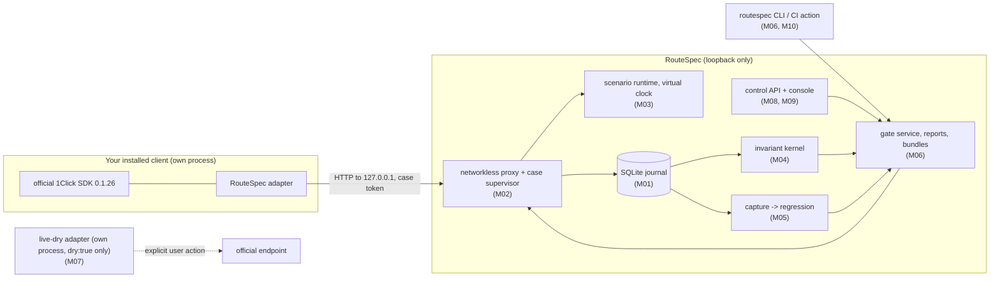

# RouteSpec

Local-first, deterministic reliability and release-regression check for applications that
integrate NEAR Intents 1Click through the official TypeScript SDK. RouteSpec runs your installed
client against a networkless, protocol-faithful local service, injects deterministic faults
(for example a commit that is accepted but whose response is lost), records what the client did
in a durable journal, and lets a pure invariant kernel decide PASS, FAIL, or REVIEW. A failing
case can be captured, reviewed, and promoted into a regression that the corrected client must
pass.

The authoritative specification is the sealed pack in [`docs/spec/`](docs/spec/START-HERE.md).
This repository implements it module by module (M00–M14).

## Status (2026-11-12, verified on win32/x64; containment on Docker Engine in WSL 2)

- All modules M00–M14 are implemented and merged locally. Exactly what passed, what is partial,
  and what is blocked is in [`BUILD-STATUS.md`](BUILD-STATUS.md), with one record per module in
  [`docs/status/`](docs/status/).
- From a clean clone, the installed product runs the whole local journey with the pinned
  official SDK: the baseline client fails the lost-response case, the failure is captured and
  promoted to a regression, and a genuinely corrected client passes (`pnpm run test:delivery`).
- **Containment (M14).** With a Linux container engine configured, every subject case runs
  confined (no network but a loopback tunnel to RouteSpec, read-only root, no capabilities,
  non-root), launches are attested by an enrolled launcher key, and an independent interceptor
  observes the protected effect. On this host the corrected client then passes every required
  predicate, INV-04 complete-effect coverage included, and its gate decision is PASS. Real escape
  attempts (direct egress, DNS, gateway, daemons, process floods, writes) are blocked
  (`pnpm run test:containment`). Without an engine those tests report NOT_RUN.
- **No `WORKING_*` gate level is claimed.** `WORKING_LOCAL` still needs a clean-checkout run on a
  real CI service (RP-05), refusal of declared-hooks-only or unconfined captures as release
  evidence (RP-08), and a review of the interceptor profile. The official live dry probe (RP-07)
  has not been run; it needs your own provider JWT.
- Enforcement is advisory: `LOCAL_ADVISORY`, `CI_CHECK`, or `REQUIRED_CHECK_UNVERIFIED`.
  RouteSpec never says it blocks a merge or a release.
- Not run: Linux and macOS hosts, Firefox and WebKit, screen readers, remote CI, an independent
  security review. What you can do next: [`docs/USER-NEXT-STEPS.md`](docs/USER-NEXT-STEPS.md).

### Dependencies (M13)

- zod 4.6.7, react-router 7.18.5, vitest 4.1.12 (tinypool no longer in the tree).
- `pnpm audit`: 5 advisories left (node-forge, dev only, held by the two-week cool-down until
  2026-11-18; minimatch through typescript-eslint).

## Requirements

- Node.js `>= 22.18` (built-in type stripping and `node:sqlite`; verified on 22.23.1)
- pnpm 10 (`corepack enable` or a global install)
- git
- Windows, Linux, or macOS. No C toolchain is needed. The console acceptance suites need
  Playwright's Chromium (`pnpm --filter @routespec/console exec playwright install chromium`).
- Optional, for subject containment: a Linux container engine (Docker Engine on Linux, or Docker
  Engine inside WSL 2 on Windows; Docker Desktop is not needed) and the image
  `node:22-bookworm-slim` pulled once. Setup: [`docs/runbooks/container-containment.md`](docs/runbooks/container-containment.md).

## Install and build

```sh
pnpm install --frozen-lockfile     # works with --offline once the pnpm store has the lockfile's packages
pnpm run build                     # tsc -b over all project references (strict)
pnpm run build:console             # production console bundle in apps/console/dist
```

## Run it

```sh
# Loopback control service (127.0.0.1) with the console, journal in ./.data
node packages/control-api/src/main.ts --data .data --console apps/console/dist
```

The service prints one JSON line with its origin. On an interactive terminal it also prints a
one-time console URL whose `#token=` fragment carries the ephemeral control token (removed from
the address bar on load). Every `/__routespec/v1` request needs `Authorization: Bearer <token>`;
mutations need `Idempotency-Key` and, for updates, `If-Match`.

The `routespec` CLI (`node packages/cli/src/main.ts <command>`) prints one JSON document on stdout.
Exit codes: 0 PASS, 2 FAIL, 3 REVIEW or NOT_RUN, 4 configuration error, 5 internal or corrupted
state, 6 safety policy denial. Main commands: `project create`, `revision register`,
`build register`, `effect manifest`, `effect policy`, `scenario validate|add`, `corpus create`,
`gate create|run|evaluate|show`, `case recover`, `export plan|write|verify`. `gate run` hands each
case to your client through the reviewed launcher (`runWithLauncher` from `@routespec/cli`);
RouteSpec never runs your commands.

The end-to-end journey (`pnpm run delivery:journey -- --work <empty dir> --out <file.json>`)
drives a fresh data directory through the control API, console, and CLI with the two reference
client builds, and writes the evidence record to the JSON file. Add `--contained` (with
`ROUTESPEC_CONTAINER_CLI` set) to run every subject case confined, with attested launches.

Containment in the service: start it with `--subject-root <checkout> --container-cli '<json>'
--launcher packages/containment/src/attesting-launcher.ts --launcher-key <key file>` and start
cases with `POST /__routespec/v1/case-runs/{id}/contained-start`; the case token goes only to the
confined subject. Details in the runbook.

## Verify

| Command                       | What it does                                                                                                                                                                                                            |
| ----------------------------- | ----------------------------------------------------------------------------------------------------------------------------------------------------------------------------------------------------------------------- |
| `pnpm run check`              | typecheck (all projects), ESLint, Prettier check, the Vitest suite, repository secret scan                                                                                                                              |
| `pnpm test`                   | Vitest suite for every package (`packages/*/test`, `apps/*/test`)                                                                                                                                                       |
| `pnpm run test:e2e:real`      | builds the console, starts a real control service seeded through the API by official-SDK subjects, runs Playwright + axe (T-047..T-052)                                                                                 |
| `pnpm run test:delivery`      | clones HEAD into an empty directory, installs offline, builds, runs the full journey, regressions, uninstall and reinstall (T-054, T-055), and the contained journey when an engine is configured (about three minutes) |
| `pnpm run test:containment`   | container runtime tests: real escape attempts and contained cases through the control service (NOT_RUN with a reason when no engine is reachable)                                                                       |
| `pnpm run test:e2e`           | console fixture suite (simulated API; development only)                                                                                                                                                                 |
| `pnpm run audit:supply-chain` | offline lockfile, license, and install-script audit                                                                                                                                                                     |

Node prints an `ExperimentalWarning` for `node:sqlite`; it is expected.

## How it fits together



The scenario runtime never has a network path or a provider credential. The live-dry adapter is
a separate process with its own compatibility ledger; its result never changes a local verdict.

## Layout

```text
packages/contracts         M00  closed versioned schemas, enums, rs-canon/1 digests, oneclick-v0 protocol profile
packages/store             M01  single-writer node:sqlite WAL journal, migrations 001-008, fenced tokens and recovery
packages/proxy             M02  networkless loopback proxy, case supervisor, redaction, interceptor channel
packages/client-adapter    M02  attaches the pinned official SDK to the proxy
packages/scenario          M03  data-only scenario DSL, compiler, virtual clock, deterministic faults, core scenarios
packages/kernel            M04  pure invariant kernel INV-01..INV-08, evidence classes and scopes
packages/regressions       M05  quarantine, sanitization, mapping, replay verification, review, promotion, corpora
packages/runner            M06  gate service, aggregation, JSON/JUnit/SARIF reports, checksummed bundles
packages/cli               M06  `routespec` CLI and the reviewed launcher
packages/live-dry-adapter  M07  separately launched dry-quote adapter (official SDK pin lives here)
packages/control-api       M08  loopback control API, attestation, build matrix, console hosting
apps/console               M09  accessible React console over the control API
packages/ci                M10  `routespec-ci` (trust classification, redacted uploads, SBOM); .github/
packages/hardening         M11  path policy, canary scanner, OS views, supply-chain audit
packages/security-suite    M11  security acceptance tests against the assembled product
packages/delivery          M12  clean install, end-to-end journey (uncontained and contained), delivery tests
packages/containment       M14  container launcher, loopback tunnel, containment verification, attesting launcher
docs/adr                        architecture decision records 0001-0019
docs/runbooks                   container-containment.md (WSL 2 + Docker Engine setup and use)
docs/status                     per-module evidence
docs/spec                       sealed specification pack (never edited)
```

## Module notes

- **Proxy and adapter (M02).** The proxy serves only `/v0/quote`, `/v0/deposit/submit`, and
  `/v0/status` on 127.0.0.1; unknown routes never pass through.
- **Kernel (M04).** A pure function from a journal snapshot to verdicts with separate evidence
  class, scope, and reason. Declared hooks alone are REVIEW for protected effects.
- **Capture-to-regression (M05).** A failing installed case is captured, quarantined, sanitized,
  mapped, replay-verified (including a separate process), reviewed (8 decisions plus a
  confirmation phrase), and promoted into a new scenario and a new corpus. It counts as fixed
  only after a different build passes the promoted case through the normal path.
- **Release gates (M06).** Gate runs are immutable; an interrupted case never contributes PASS;
  reports come from one persisted evaluation; `export plan|write|verify` produces a redacted,
  checksummed (unsigned) bundle, and artifact readiness never changes the decision.
- **Live dry adapter (M07).** At most one `dry: true` quote to the pinned official origin, with
  every committed or fund-moving request denied before credential, DNS, or socket. Run only on
  your explicit action: see `docs/USER-NEXT-STEPS.md`.
- **Control API (M08).** Host, Origin, and Fetch-Metadata are checked on every request; no CORS
  is granted; attester enrollment needs a second local confirmation code.
- **Console (M09).** Renders persisted records only and never computes a verdict; keyboard
  complete, WCAG 2.2 AA checked with axe, responsive from 375 px.
- **CI (M10).** `routespec-ci run --config routespec.ci.json` through the reviewed launcher;
  pull-request and fork jobs get no provider secrets and upload only redacted reports; CI builds
  stay `USER_ASSERTED_LOCAL`. Remote runs have not happened yet.
- **Containment (M14).** `@routespec/containment` detects the engine, starts the subject's process
  tree in a container whose only channel is a stdio tunnel to the proxy and the interceptor sink,
  verifies the engine's record and the container's self-observation (fail closed), and supplies
  the attesting launcher. The service binds the interceptor at the case's current epoch, releases
  protected effects only after ground truth proves accepted completion, and journals an immutable
  containment record per case. Gate runs may select one effect policy per scenario.
- **Hardening (M11).** `ROUTESPEC_CONFIGURED_SECRETS` (one value per line, read once) are refused
  or redacted at every boundary; `--handoff stderr|ipc|none`; local logs in
  `<data>/logs/control.jsonl`; `GET /__routespec/v1/metrics` (no telemetry); retention purge with
  a dry run and a confirmation digest.

## Safety boundary

RouteSpec has no funded mode. Nothing in this repository creates accounts, holds a provider
credential, signs a transaction, moves funds, or contacts the hosted 1Click API on its own. The
only modes are SIMULATE and REPLAY (networkless) and LIVE_DRY_PROBE (a separate adapter process,
`dry: true` only, after an explicit user action). RouteSpec is an independent project; it shares
no code, state, or repository with any other submission.
