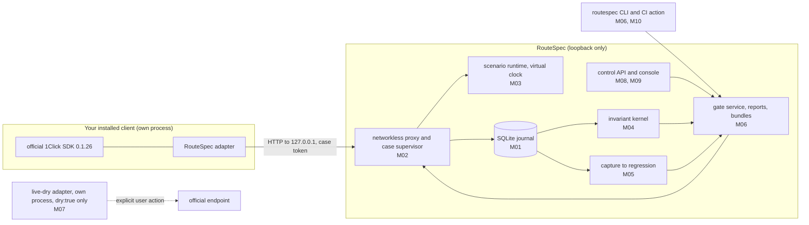

# RouteSpec architecture and engineering reference

This is the detailed reference that used to live in the README. The README is the short,
judge-facing entry point; the per-module evidence is in [`docs/status/`](status/), the claim
record in [`BUILD-STATUS.md`](../BUILD-STATUS.md), and the sealed specification in
[`docs/spec/`](spec/START-HERE.md) (never edited). Decisions beyond the specification are ADRs
in [`docs/adr/`](adr/).

## Requirements

- Node.js `>= 22.18` (built-in type stripping and `node:sqlite`; verified on 22.23.1)
- pnpm 10 (`corepack enable` or a global install)
- git
- Windows, Linux, or macOS. No C toolchain is needed. The console acceptance suites need
  Playwright's Chromium (`pnpm --filter @routespec/console exec playwright install chromium`).
- Optional, for subject containment: a Linux container engine (Docker Engine on Linux, or Docker
  Engine inside WSL 2 on Windows; Docker Desktop is not needed) and the image
  `node:22-bookworm-slim` pulled once. Setup: [`docs/runbooks/container-containment.md`](runbooks/container-containment.md).

## Install and build

```sh
pnpm install --frozen-lockfile     # works with --offline once the pnpm store has the lockfile's packages
pnpm run build                     # tsc -b over all project references (strict)
pnpm run build:console             # production console bundle in apps/console/dist
```

## Run it

```sh
# Loopback control service (127.0.0.1) with the console, journal in ./.data
node packages/control-api/src/main.ts --data .data --console apps/console/dist
```

The service prints one JSON line with its origin. On an interactive terminal it also prints a
one-time console URL whose `#token=` fragment carries the ephemeral control token (removed from
the address bar on load). Every `/__routespec/v1` request needs `Authorization: Bearer <token>`;
mutations need `Idempotency-Key` and, for updates, `If-Match`.

The `routespec` CLI (`node packages/cli/src/main.ts <command>`) prints one JSON document on stdout.
Exit codes: 0 PASS, 2 FAIL, 3 REVIEW or NOT_RUN, 4 configuration error, 5 internal or corrupted
state, 6 safety policy denial. Main commands: `project create`, `revision register`,
`build register`, `effect manifest`, `effect policy`, `scenario validate|add`, `corpus create`,
`gate create|run|evaluate|show`, `case recover`, `regression evidence|promote [--diagnostic-only]`,
`profile review-status|review-sign`, `export plan [--evidence-use]|write|verify`. `gate run` hands each
case to your client through the reviewed launcher (`runWithLauncher` from `@routespec/cli`);
RouteSpec never runs your commands.

The end-to-end journey (`pnpm run delivery:journey -- --work <empty dir> --out <file.json>`)
drives a fresh data directory through the control API, console, and CLI with the two reference
client builds, and writes the evidence record to the JSON file. Add `--contained` (with
`ROUTESPEC_CONTAINER_CLI` set) to run every subject case confined, with attested launches.

Containment in the service: start it with `--subject-root <checkout> --container-cli '<json>'
--launcher packages/containment/src/attesting-launcher.ts --launcher-key <key file>` and start
cases with `POST /__routespec/v1/case-runs/{id}/contained-start`; the case token goes only to the
confined subject. Details in the runbook.

## Verify

| Command                       | What it does                                                                                                                                                                                                            |
| ----------------------------- | ----------------------------------------------------------------------------------------------------------------------------------------------------------------------------------------------------------------------- |
| `pnpm run check`              | typecheck (all projects), ESLint, Prettier check, the Vitest suite, repository secret scan                                                                                                                              |
| `pnpm test`                   | Vitest suite for every package (`packages/*/test`, `apps/*/test`)                                                                                                                                                       |
| `pnpm run test:e2e:real`      | builds the console, starts a real control service seeded through the API by official-SDK subjects, runs Playwright + axe (T-047..T-052)                                                                                 |
| `pnpm run test:delivery`      | clones HEAD into an empty directory, installs offline, builds, runs the full journey, regressions, uninstall and reinstall (T-054, T-055), and the contained journey when an engine is configured (about three minutes) |
| `pnpm run test:containment`   | container runtime tests: real escape attempts, container-host access (T-036), and contained cases through the control service (NOT_RUN with a reason when no engine is reachable)                                       |
| `pnpm run test:e2e`           | console fixture suite (simulated API; development only)                                                                                                                                                                 |
| `pnpm run audit:supply-chain` | offline lockfile, license, and install-script audit                                                                                                                                                                     |

Node prints an `ExperimentalWarning` for `node:sqlite`; it is expected.

## The RouteSpec gate in your CI

The repository contains a composite GitHub Action,
[`.github/actions/routespec-gate`](../.github/actions/routespec-gate/action.yml). It installs
RouteSpec's pinned dependencies, removes provider secrets and CI tokens before its entry point
starts, runs the networkless gate (simulate and replay only), and stages redacted reports
(JSON, JUnit, SARIF, evidence bundle). The step exits 0 only for a PASS decision.

1. Add a `routespec.ci.json` (schema `routespec.ci-config/1`) to your repository. It names your
   client module, its artifact files, lockfile, declared effect manifest, scenarios, and required
   invariants. The repository's own self-gate config is a working example:
   [`.github/routespec/routespec.ci.json`](../.github/routespec/routespec.ci.json).
2. Add a workflow step, pinned to a reviewed commit of this repository:

   ```yaml
   permissions:
     contents: read
   jobs:
     routespec:
       runs-on: ubuntu-24.04
       steps:
         - uses: actions/checkout@11bd71901bbe5b1630ceea73d27597364c9af683 # v4.2.2
           with:
             persist-credentials: false
         - id: gate
           uses: gnanam1990/routespec-near/.github/actions/routespec-gate@<reviewed-commit-sha>
           with:
             config: routespec.ci.json
         - if: ${{ always() && steps.gate.outputs.upload-directory != '' }}
           uses: actions/upload-artifact@b4b15b8c7c6ac21ea08fcf65892d2ee8f75cf882 # v4.4.3
           with:
             name: routespec-gate-${{ github.run_id }}
             path: ${{ steps.gate.outputs.upload-directory }}
             retention-days: ${{ steps.gate.outputs.retention-days }}
   ```

   A reusable-workflow version is in
   [`docs/ci/routespec-gate.reusable.example.yml`](ci/routespec-gate.reusable.example.yml).

3. Outputs: `conclusion`, `decision`, `exit-code`, `trust`, `enforcement-mode`, `artifact-ready`.
   Pull-request and fork jobs get no secrets and upload only redacted reports. Enforcement is
   reported as `CI_CHECK` or `REQUIRED_CHECK_UNVERIFIED`; RouteSpec never claims it blocks a
   merge. The action does not use containment.

The action's behaviour was tested with a simulated runner environment (T-056, T-058), and it has
run on GitHub's hosted runners: the repository's self-gate workflow `routespec-gate`
(ubuntu-24.04) succeeded on `main` at `ab9b89f`
([run 43272644038](https://github.com/gnanam1990/routespec-near/actions/runs/43272644038)) and at
`bfd3065` ([run 43357797080](https://github.com/gnanam1990/routespec-near/actions/runs/43357797080)).
The step exits 0 only for a PASS decision, so the sample subject's gate decision was PASS.

## How it fits together



The scenario runtime never has a network path or a provider credential. The live-dry adapter is
a separate process with its own compatibility ledger; its result never changes a local verdict.

## Layout

```text
packages/contracts         M00  closed versioned schemas, enums, rs-canon/1 digests, oneclick-v0 protocol profile
packages/store             M01  single-writer node:sqlite WAL journal, migrations 001-009, fenced tokens, recovery, reviews
packages/proxy             M02  networkless loopback proxy, case supervisor, redaction, interceptor channel
packages/client-adapter    M02  attaches the pinned official SDK to the proxy
packages/scenario          M03  data-only scenario DSL, compiler, virtual clock, deterministic faults, core scenarios
packages/kernel            M04  pure invariant kernel INV-01..INV-08, evidence classes and scopes
packages/regressions       M05  quarantine, sanitization, mapping, replay verification, review, promotion, corpora
packages/runner            M06  gate service, aggregation, JSON/JUnit/SARIF reports, checksummed bundles
packages/cli               M06  `routespec` CLI and the reviewed launcher
packages/live-dry-adapter  M07  separately launched dry-quote adapter (official SDK pin lives here)
packages/control-api       M08  loopback control API, attestation, build matrix, console hosting
apps/console               M09  accessible React console over the control API
packages/ci                M10  `routespec-ci` (trust classification, redacted uploads, SBOM); .github/
packages/hardening         M11  path policy, canary scanner, OS views, supply-chain audit
packages/security-suite    M11  security acceptance tests against the assembled product
packages/delivery          M12  clean install, end-to-end journey (uncontained and contained), delivery tests
packages/containment       M14  container launcher, loopback tunnel, containment verification, attesting launcher
docs/adr                        architecture decision records 0001-0033
docs/runbooks                   container containment, interceptor profile review, release certificates, certified badge
docs/status                     per-module evidence
docs/spec                       sealed specification pack (never edited)
```

Branches: each module was built on its own `feat/routespec-mNN-*` branch and merged into `main`
with `--no-ff`; every branch is kept. M00–M18 are the build modules, M19 the reviewer kits, and
M40 onward the hackathon write-up and screening fixes. The `feat/routespec-m20-*` to
`feat/routespec-m29-*` branches are not modules: they are security-fix branches, one per audit
finding (m20 vuln-0001, m21 vuln-0002, m22 vuln-0003, m23 RS-01, m24 RS-02, m25 RS-03, m26 RS-04,
m27 RS-05, m28 RS-06, m29 RS-07; see [Security](../README.md#security)).

## Module notes

- **Proxy and adapter (M02).** The proxy serves only `/v0/quote`, `/v0/deposit/submit`, and
  `/v0/status` on 127.0.0.1; unknown routes never pass through.
- **Kernel (M04).** A pure function from a journal snapshot to verdicts with separate evidence
  class, scope, and reason. Declared hooks alone are REVIEW for protected effects.
- **Capture-to-regression (M05).** A failing installed case is captured, quarantined, sanitized,
  mapped, replay-verified (including a separate process), reviewed (8 decisions plus a
  confirmation phrase), and promoted into a new scenario and a new corpus. It counts as fixed
  only after a different build passes the promoted case through the normal path.
- **Release-evidence refusal and profile review (M16).** One journal-derived classification
  (`GET /imports/{id}/release-evidence`, `routespec regression evidence`) decides whether a
  capture is release evidence; promotion, corpora, gate aggregation (`routespec-gate@1.2.0`),
  and export all apply it. Reviewers are separate principals (migration 009) enrolled with a
  local confirmation; a review is an Ed25519 signature over a server-built statement
  (`routespec profile review-sign` signs offline), immutable, and revocable only by an
  append-only record. INV-04 (`routespec-kernel@1.1.0`) needs an effective review recorded before
  the case input closed, so gate runs pinned to the 1.0.0 evaluator are `GATE_EVALUATOR_STALE`.
- **Release gates (M06).** Gate runs are immutable; an interrupted case never contributes PASS;
  reports come from one persisted evaluation; `export plan|write|verify` produces a redacted,
  checksummed (unsigned) bundle, and artifact readiness never changes the decision. Bundles are
  `routespec.bundle/2` since M16: they declare `evidenceUse` and carry the signed profile
  reviews, which `verify` checks offline.
- **Live dry adapter (M07).** At most one `dry: true` quote to the pinned official origin, with
  every committed or fund-moving request denied before credential, DNS, or socket. Run only on
  your explicit action: see `docs/USER-NEXT-STEPS.md`.
- **Control API (M08).** Host, Origin, and Fetch-Metadata are checked on every request; no CORS
  is granted; attester enrollment needs a second local confirmation code.
- **Console (M09).** Renders persisted records only and never computes a verdict; keyboard
  complete, WCAG 2.2 AA checked with axe, responsive from 375 px.
- **CI (M10).** `routespec-ci run --config routespec.ci.json` through the reviewed launcher;
  pull-request and fork jobs get no provider secrets and upload only redacted reports; CI builds
  stay `USER_ASSERTED_LOCAL`. Hosted runs: `ci` and `routespec-gate` green on GitHub Actions
  (see [Honest status](../README.md#honest-status)).
- **Containment (M14).** `@routespec/containment` detects the engine, starts the subject's process
  tree in a container whose only channel is a stdio tunnel to the proxy and the interceptor sink,
  verifies the engine's record and the container's self-observation (fail closed), and supplies
  the attesting launcher. The service binds the interceptor at the case's current epoch, releases
  protected effects only after ground truth proves accepted completion, and journals an immutable
  containment record per case. Gate runs may select one effect policy per scenario.
- **Container-host access (M17).** The T-036 runtime test starts RouteSpec's real listeners on
  this host and tries every port at every host, engine-host, gateway, and loopback address from a
  bridge container, a host-network container, and the confined subject, with a positive control
  that proves the attempts are not vacuous. The launcher now requires `Seccomp: 2` in the
  container's self-observation and closes every tunnel connection with the subject.
- **Hardening (M11).** `ROUTESPEC_CONFIGURED_SECRETS` (one value per line, read once) are refused
  or redacted at every boundary; `--handoff stderr|ipc|none`; local logs in
  `<data>/logs/control.jsonl`; `GET /__routespec/v1/metrics` (no telemetry); retention purge with
  a dry run and a confirmation digest.

## Safety boundary

RouteSpec has no funded mode. Nothing in this repository creates accounts, holds a provider
credential, signs a transaction, moves funds, or contacts the hosted 1Click API on its own. The
only modes are SIMULATE and REPLAY (networkless) and LIVE_DRY_PROBE (a separate adapter process,
`dry: true` only, after an explicit user action). RouteSpec is an independent project; it shares
no code, state, or repository with any other submission.

## Modules added during the hackathon write-up stages (M42 onward)

| Package or path                                                | Module | What it is                                                                                               | Evidence                       |
| -------------------------------------------------------------- | ------ | -------------------------------------------------------------------------------------------------------- | ------------------------------ |
| `packages/live-dry-adapter` (echo equivalence)                 | M42    | official `dry: true` probe; documented provider normalisation accepted as an equivalent echo             | [M42](status/M42.md)           |
| `packages/live-dry-adapter` (`fidelity:matrix`)                | M51    | 26-route `dry: true` fidelity matrix, hard cap of 40 requests, scheduled drift job                       | [M51](status/M51.md), ADR-0027 |
| `packages/incident-corpus`                                     | M50    | read-only Intents Explorer importer, sanitised incident templates, observed-incident corpus              | [M50](status/M50.md), ADR-0028 |
| `contracts/routespec-registry`, `packages/registry`            | M47    | release certificates: attester registry contract (no funds), payload, NEAR JSON-RPC client, CLI, CI step | [M47](status/M47.md), ADR-0029 |
| `examples/third-party`, `packages/delivery/src/third-party.ts` | M48    | pinned, digest-checked official SDK example run inside the subject container                             | [M48](status/M48.md), ADR-0030 |
| `apps/verify`, `packages/registry/src/badge.ts`                | M49    | static verify page (browser SHA-256 + read-only RPC) and the "RouteSpec Certified" badge JSON            | [M49](status/M49.md), ADR-0031 |
| `packages/distribution`                                        | M54    | npm package, Marketplace action metadata, recorded read-only console demo, `pnpm judge`                  | [M54](status/M54.md), ADR-0032 |
| `packages/fix-patterns`                                        | M53    | fix patterns linked to violated invariants, SDK usage found, suggested unified diff                      | [M53](status/M53.md), ADR-0032 |
| `packages/mcp`, `examples/agent-skill`                         | M52    | MCP stdio server (`routespec mcp`, five tools) and a skill for coding agents                             | [M52](status/M52.md), ADR-0033 |
| registry audit fixes                                           | M47A   | small-order Ed25519 attester keys refused in the contract, verifier and CLI                              | [M47A](status/M47A.md)         |

More commands from these modules:

```sh
pnpm judge [--contained] [--skip-package]   # one-command reviewer check (M54)
pnpm run test:registry                      # registry contract on a local nearcore sandbox node (needs a container engine)
pnpm run registry:reproduce                 # reproducible registry wasm build
pnpm run examples:fetch && pnpm run examples:third-party -- --work <dir> --out <file>   # M48, contained
pnpm run mcp                                # MCP stdio server (M52)
pnpm run demo:agent-session                 # scripted agent session (M52)
pnpm run package:npm                        # npm package tarball (M54)
pnpm run test:distribution                  # installed tarball and the demo site (M54)
```
